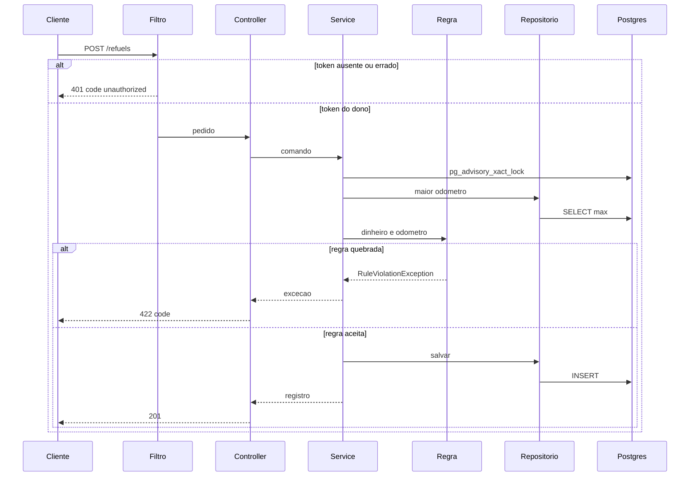

# API Design

**Spec**: `.specs/features/api/spec.md`
**Status**: Draft

---

## Architecture Overview

A regra de dinheiro, odômetro e consumo é Java puro. Ela não importa Spring. O `RefuelService` é a porta Spring: abre a transação, segura o lock, chama a regra e o repositório. O controller, o `@RestControllerAdvice` e o filtro do token só traduzem HTTP.

O processo usa Java 21 e Spring Boot 4.1.2. O build é Maven. Os starters são `spring-boot-starter-webmvc`, `spring-boot-starter-data-jpa`, `spring-boot-starter-security` e o starter do Flyway. O Hibernate implementa o JPA. O schema nasce de migração Flyway, com `ddl-auto` em `validate`.

Não existe linha de dono para travar. O contrato não tem dono nem veículo. O lock compartilhado é `pg_advisory_xact_lock` no início da transação de escrita. Ele faz o papel que a conversa chamou de "linha do dono": o segundo POST espera, relê o maior odômetro e só então decide. O índice único de `odometer_km` continua sendo o que recusa o valor repetido.

Identificadores, rotas, JSON, códigos de erro e colunas estão em inglês. AD-004. O glossário mora em `.specs/project.md`.



---

## Code Reuse Analysis

### Existing Components to Leverage

Não há código Java no repositório. Nada a reaproveitar.

### Integration Points

| System | Integration Method |
| --- | --- |
| Postgres | JPA. Flyway cria a tabela. Testes de concorrência usam Testcontainers. |
| Bot do Telegram | Feature futura. Chama `RefuelService` no mesmo processo. Não vê entidade JPA nem HTTP. |
| Relógio | `Clock` fixo em `America/Sao_Paulo`, injetado no service. O teste controla o dia. |

---

## Components

### Money

- **Purpose**: Completa o campo de dinheiro que faltou e recusa par fora do limite ou da tolerância de R$ 0,01.
- **Location**: `src/main/java/watchmyride/refuel/Money.java`
- **Interfaces**:
  - `complete(liters, pricePerLiter, totalAmount): Amounts` — devolve litros, preço e total já em `BigDecimal` com escala 3, 3 e 2. `HALF_UP`.
- **Dependencies**: nenhuma de framework
- **Reuses**: nenhum

### Odometer

- **Purpose**: Decide se um km novo cabe na sequência estrita.
- **Location**: `src/main/java/watchmyride/refuel/Odometer.java`
- **Interfaces**:
  - `acceptsInsert(highestStored, next)` — `next` tem de ser maior que o maior gravado. Sem registro gravado, qualquer km dentro do limite passa.
  - `acceptsUpdate(previous, next, following)` — maior que o vizinho anterior, quando existe, e menor que o seguinte, quando existe.
- **Dependencies**: nenhuma de framework
- **Reuses**: nenhum

### Consumption

- **Purpose**: Monta os trechos entre tanques cheios e o trecho aberto.
- **Location**: `src/main/java/watchmyride/refuel/Consumption.java`
- **Interfaces**:
  - `calculate(recordsInOdometerOrder): Result` — `segments` com `km`, `liters` e `km_per_liter`. `open` nulo quando não há litros depois do último cheio. Os litros do cheio que abre o trecho ficam de fora. `km_per_liter` sai com 3 casas, `HALF_UP`.
- **Dependencies**: nenhuma de framework
- **Reuses**: nenhum

### RuleViolationException

- **Purpose**: Carrega o `code` da spec quando a regra quebra.
- **Location**: `src/main/java/watchmyride/refuel/RuleViolationException.java`
- **Interfaces**:
  - `code(): String`
- **Dependencies**: `RuntimeException`
- **Reuses**: nenhum

### RefuelService

- **Purpose**: Porta da feature. Transação, lock, tradução da falha de integridade e chamadas à regra e ao repositório.
- **Location**: `src/main/java/watchmyride/refuel/RefuelService.java`
- **Interfaces**:
  - `create(command): Refuel`
  - `list(): List<Refuel>` — ordem decrescente de `odometer_km`
  - `get(id): Refuel`
  - `update(id, command): Refuel`
  - `delete(id)`
  - `consumption(): Result`
  - `spending(month): BigDecimal` — `month` nulo usa o mês civil de hoje
- **Dependencies**: repositório, `Clock`, as três regras
- **Reuses**: `Money`, `Odometer`, `Consumption`

`create` e `update` rodam em `@Transactional`. Antes de ler o maior odômetro, chamam `pg_advisory_xact_lock`. Se o `INSERT` ou o `UPDATE` ferir o índice único, o service lança `RuleViolationException("duplicate_odometer")`.

### RefuelEntity e repositório

- **Purpose**: A linha no Postgres e as buscas. Não calcula dinheiro nem consumo.
- **Location**: `src/main/java/watchmyride/persistence/RefuelEntity.java`, `RefuelRepository.java`
- **Interfaces**:
  - `save`, `findById`, `findAllByOrderByOdometerKmDesc`, `deleteById`
  - `highestOdometer(): Optional<Integer>`
- **Dependencies**: Spring Data JPA
- **Reuses**: nenhum

### RefuelController

- **Purpose**: Traduz JSON em comando e registro em JSON. Não decide regra.
- **Location**: `src/main/java/watchmyride/api/RefuelController.java`
- **Interfaces**:
  - `POST /refuels` — 201 e o registro
  - `GET /refuels` — 200 e a lista
  - `GET /refuels/{id}` — 200 e o registro
  - `PUT /refuels/{id}` — 200 e o registro
  - `DELETE /refuels/{id}` — 204
  - `GET /refuels/consumption` — 200
  - `GET /refuels/spending?month=` — 200
- **Dependencies**: `RefuelService`
- **Reuses**: nenhum

Os caminhos `/consumption` e `/spending` ficam declarados antes de `/{id}`.

### ApiExceptionHandler

- **Purpose**: Traduz `RuleViolationException` no JSON de um campo e qualquer outra exceção não tratada em 500.
- **Location**: `src/main/java/watchmyride/api/ApiExceptionHandler.java`
- **Interfaces**:
  - trata `RuleViolationException` com o status do código
  - trata corpo ilegível e tipo errado
  - trata o resto com 500 `internal_error` e registra a exceção no log
- **Dependencies**: Spring MVC
- **Reuses**: `RuleViolationException`

### SecurityConfig

- **Purpose**: Exige `Authorization: Bearer` igual ao token do dono, lido de variável de ambiente. Fora isso, responde 401 e não chama o controller.
- **Location**: `src/main/java/watchmyride/api/SecurityConfig.java`
- **Interfaces**:
  - cadeia de filtros do Spring Security
  - ponto de entrada que escreve `{"code":"unauthorized"}`
- **Dependencies**: Spring Security
- **Reuses**: nenhum

---

## Data Models

### Refuel

```java
record Refuel(
    long id,
    BigDecimal liters,
    BigDecimal pricePerLiter,
    BigDecimal totalAmount,
    LocalDate date,
    int odometerKm,
    boolean fullTank,
    String station
) {}
```

**Relationships**: nenhum outro agregado. Um carro implícito.

O JSON usa os nomes da spec: `id`, `liters`, `price_per_liter`, `total_amount`, `date`, `odometer_km`, `full_tank`, `station`. `station` sai `null` quando não foi enviado. `date` é `YYYY-MM-DD`.

### Consumption

```json
{
  "segments": [
    { "km": 200, "liters": 22.000, "km_per_liter": 9.091 }
  ],
  "open": null
}
```

`open`, quando existe, tem `liters` e `km_per_liter` nulo.

### Spending

```json
{ "month": "2026-11", "total_amount": 235.96 }
```

`month` é o mês efetivo, inclusive quando o cliente omitiu o parâmetro.

### Tabela `refuel`

| Coluna | Tipo |
| --- | --- |
| `id` | `bigint` gerado, chave |
| `liters` | `numeric(6,3)` |
| `price_per_liter` | `numeric(5,3)` |
| `total_amount` | `numeric(10,2)` |
| `date` | `date` |
| `odometer_km` | `integer`, único |
| `full_tank` | `boolean` |
| `station` | `varchar(80)`, nulo |

A migração é `src/main/resources/db/migration/V1__refuel.sql`.

---

## Error Handling Strategy

| Error Scenario | Handling | User Impact |
| --- | --- | --- |
| Token ausente ou diferente | O filtro responde | 401 `unauthorized` |
| Campo ausente, tipo errado, `full_tank` não booleano | `RuleViolationException` ou corpo ilegível | 422 `required_field` |
| `date` fora de `YYYY-MM-DD` | exceção de domínio | 422 `invalid_date` |
| `month` fora de `YYYY-MM` | exceção de domínio | 422 `invalid_month` |
| Limite de litros, preço, total, odômetro ou posto | exceção de domínio | 422 `invalid_liters`, `invalid_price`, `invalid_amount`, `invalid_odometer` ou `invalid_station` |
| Preço e total discordam em mais de R$ 0,01 | exceção de domínio | 422 `inconsistent_amount` |
| Odômetro menor que o maior, ou fora dos vizinhos | exceção de domínio, depois do lock | 422 `regressive_odometer` |
| Odômetro repetido | índice único, o service traduz | 422 `duplicate_odometer` |
| Id ausente | exceção de domínio | 404 `not_found` |
| Qualquer outra exceção | advice registra o stack e responde | 500 `internal_error` |

Todo corpo de erro é `{"code":"..."}`. Sem `message`.

Códigos e status: 401 `unauthorized`, 404 `not_found`, 422 os demais tratados, 500 `internal_error`.

---

## Risks & Concerns

| Concern | Location | Impact | Mitigation |
| --- | --- | --- | --- |
| Não há código nem teste ainda | repositório | A regra pode escorregar para o controller | Testes de `Money`, `Odometer` e `Consumption` sem Spring. Teste HTTP só na borda. |
| H2 não executa `pg_advisory_xact_lock` | concorrência | O critério dos dois POST passaria num banco falso | Testcontainers com Postgres. |
| `BigDecimal` construído a partir de `double` | JSON de entrada | O preço ganha ruído binário | O campo do DTO é `BigDecimal`. O parser usa os dígitos do JSON. |
| Índice único engole outra falha de integridade | service | Um erro de schema viraria `duplicate_odometer` | O service só traduz a violação do índice de `odometer_km`. O resto segue para 500. |

---

## Tech Decisions

| Decision | Choice | Rationale |
| --- | --- | --- |
| Forma | Regra pura, Spring na borda, JPA | Usuário: "Vamos de 1." AD-003. |
| Idioma | Identificadores em inglês | AD-004. Prosa da spec continua em português. |
| Stack | Java 21, Spring Boot 4.1.2, Maven | Boot 4.1.2 é a linha estável. Exige Java 17 ou mais. 21 é a LTS que o estudo usa. |
| Schema | Flyway, `ddl-auto=validate` | A escala `numeric` e o índice único não ficam a cargo do Hibernate. |
| Lock | `pg_advisory_xact_lock` | Não há linha de dono. O lock vive só na transação de `create` e `update`. |
| JSON numérico | número JSON, escala da spec | Total com 2 casas. Preço, litros e km/l com 3. |
| Teste de concorrência | Testcontainers | O lock e o índice único são comportamento do Postgres. |
| Token | variável de ambiente | O mesmo lugar dos outros segredos do projeto. O valor não entra no log. |

> **Project-level decisions:** AD-003, AD-004.
